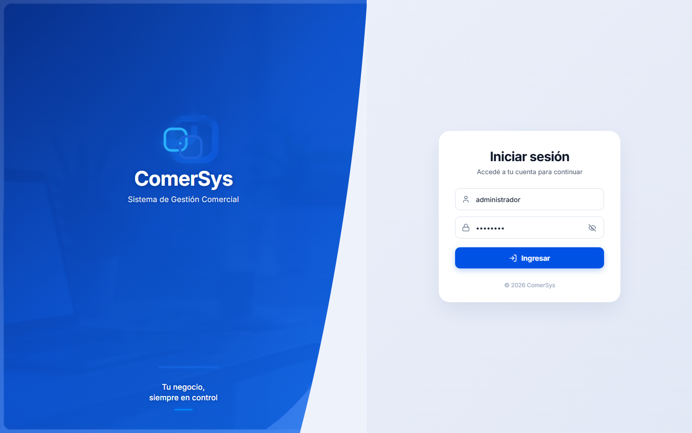

# Módulo 01: Inicio de Sesión (Login)

---

## 1. ¿Qué es este apartado?
Es la puerta de entrada y control de acceso seguro a la plataforma **ComerSys — Sistema de Gestión Comercial**. Presenta un diseño corporativo moderno dividido en dos zonas: un panel izquierdo con identidad institucional de alto nivel y fotografía corporativa con división curva orgánica, y un panel derecho con el formulario minimalista de autenticación y protección de credenciales.

---

## 2. ¿Para qué sirve?
- **Seguridad y Confidencialidad:** Garantiza que únicamente el personal autorizado y los administradores puedan acceder a los datos comerciales, inventario, saldos de clientes y registros financieros del negocio.
- **Identificación de Usuario:** Asigna la sesión activa al perfil correspondiente (ej. Administrador general o vendedor), habilitando la trazabilidad de operaciones.
- **Protección de Datos:** Previene accesos no deseados desde equipos compartidos o terminales en punto de venta.

---

## 3. ¿Cómo funciona?

### Paso a paso para iniciar sesión:
1. **Ingresar Usuario:** En el primer campo con el icono de usuario, escriba su nombre de usuario registrado (por ejemplo: `administrador`).
2. **Ingresar Contraseña:** En el segundo campo con el icono de candado, ingrese su clave secreta (por ejemplo: `admin123`).
3. **Visibilidad de Contraseña:** Si desea verificar lo que escribió antes de enviar, presione el icono del ojo ubicado a la derecha del campo para alternar entre ver los caracteres u ocultarlos.
4. **Acceder:** Haga clic en el botón azul destacado **«Ingresar»** o presione la tecla `Enter`.
5. **Validación Automática:**
   - Si los datos son correctos, el sistema valida la sesión e ingresa inmediatamente al **Panel de Inicio (Dashboard)**.
   - Si ingresa datos incorrectos, el sistema mostrará un mensaje de alerta en rojo indicando el error sin comprometer la seguridad.

---

## 4. Elementos de la Pantalla
- **Sección Institucional (Izquierda):** Logotipo corporativo de ComerSys, isotipo en doble marco cian/azul, nombre del sistema, eslogan empresarial *"Tu negocio, siempre en control"* y fotografía en alta definición con degradado profesional.
- **Tarjeta de Acceso (Derecha):** Título descriptivo, campos con validación visual en tiempo real, botón con icono de flecha de ingreso y pie de página de copyright legal.
