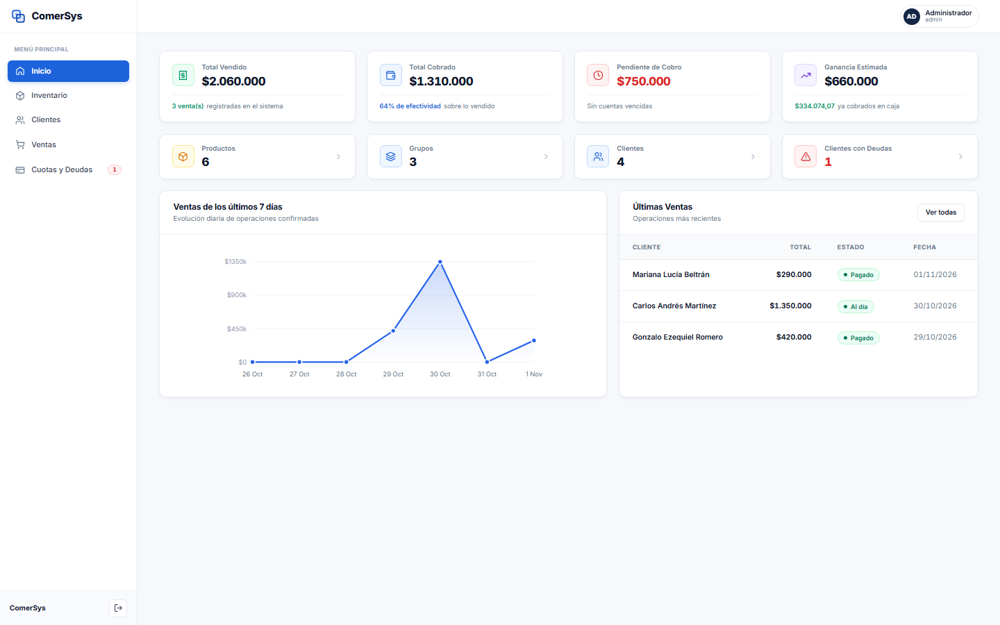

# Módulo 02: Panel de Inicio (Dashboard Ejecutivo)

---

## 1. ¿Qué es este apartado?
Es el centro de control y comando ejecutivo de **ComerSys**. Es la primera pantalla que observa el administrador tras autenticarse, diseñada con un enfoque analítico claro, limpio y directo que resume en tiempo real la salud financiera y operativa del negocio.

---

## 2. ¿Para qué sirve?
- **Monitoreo Financiero Instantáneo:** Ofrece métricas exactas calculadas en vivo sobre dinero vendido, efectivo efectivamente cobrado en caja, saldos adeudados en la calle y ganancias estimadas.
- **Detección Rápida de Riesgos de Cobro:** Destaca los montos pendientes de cobro y avisa de clientes con deudas activas o cuotas por vencer.
- **Acceso Directo a Módulos:** Tarjetas interactivas con conteos en tiempo real de productos, categorías/grupos, clientes empadronados y cuentas pendientes.
- **Análisis de Tendencias:** Gráfico vectorial de área y puntos que visualiza la curva de ventas acumuladas a lo largo de los últimos 7 días.
- **Auditoría de Actividad Reciente:** Tabla rápida con las últimas ventas registradas, cliente, importe y estado de pago.

---

## 3. ¿Cómo funciona?

### Tarjetas de Métricas Clave (KPIs Superiores):
1. **Total Vendido:** Suma el importe monetario total de todas las ventas formalizadas (tanto al contado como financiadas). Debajo muestra el número total de ventas.
2. **Total Cobrado:** Refleja el dinero que ingresó materialmente en efectivo, transferencia o tarjeta. Indica además el porcentaje de efectividad de cobranza sobre el total vendido.
3. **Pendiente de Cobro:** Muestra el capital total que los clientes aún deben abonar. Si existen cuentas vencidas o atrasadas, se resalta con alerta roja.
4. **Ganancia Estimada:** Calcula la rentabilidad comercial real restando el costo de compra de mercadería al precio de venta facturado.

### Indicadores Rápidos (Fila Media):
- **Productos:** Conteo total de ítems dados de alta en el catálogo. Un clic conduce directamente a la gestión de inventario.
- **Grupos:** Cantidad de categorías comerciales configuradas.
- **Clientes:** Padrón total de clientes registrados en el sistema.
- **Clientes con Deudas:** Conteo específico de aquellos compradores que tienen cuotas pendientes o saldo deudor activo.

### Paneles de Análisis (Fila Inferior):
- **Gráfico de Evolución (Últimos 7 Días):** Dibuja automáticamente las ventas de la semana en curso. Al colocar el cursor sobre cada nodo azul se aprecia el total diario.
- **Últimas Ventas:** Visualiza las transacciones más recientes con el nombre del cliente, importe total, estado con badge semántico (*Pagado*, *Al día*, *Atrasado*) y fecha. El botón «Ver todas» redirige al módulo completo de Ventas.
