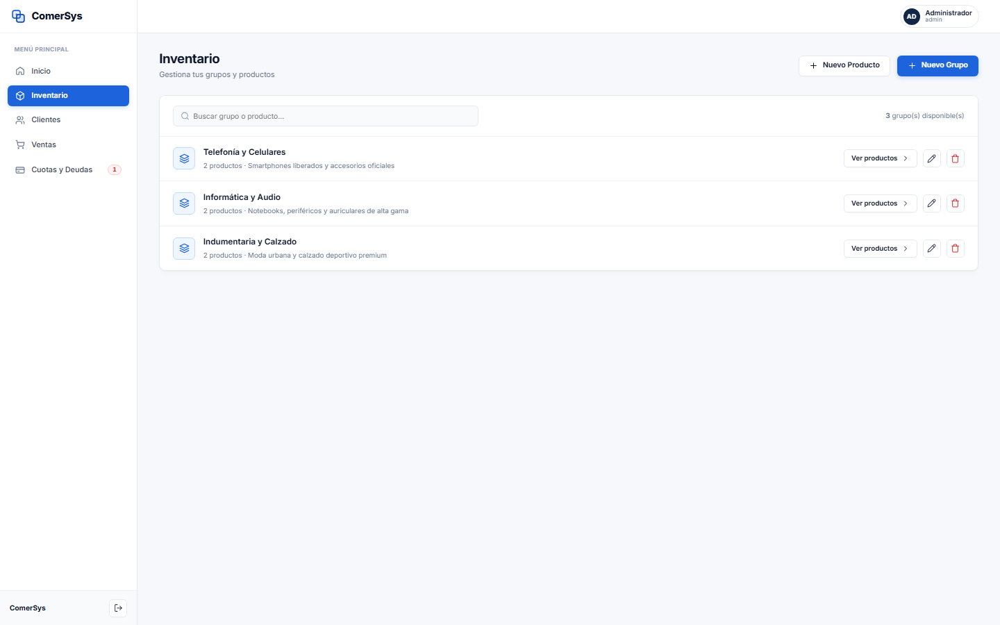
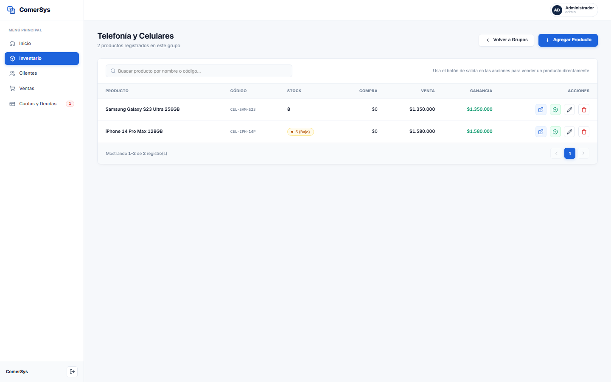
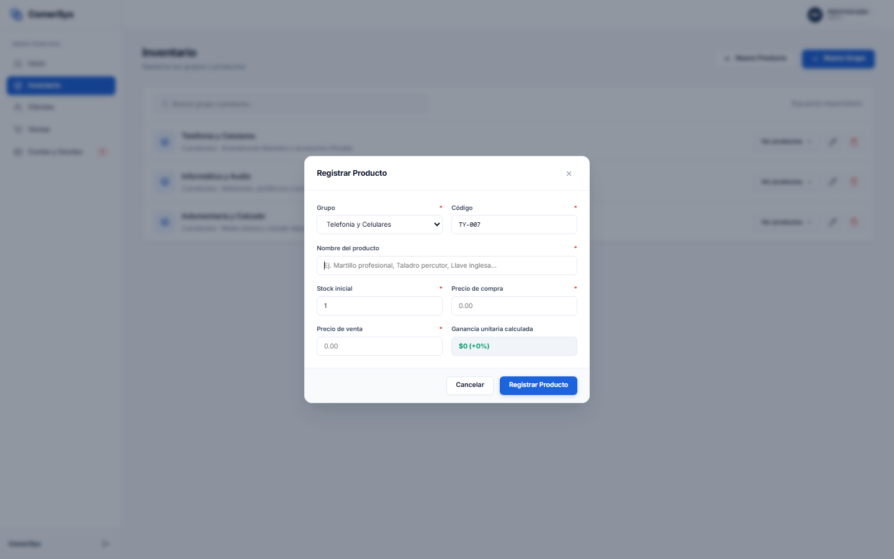
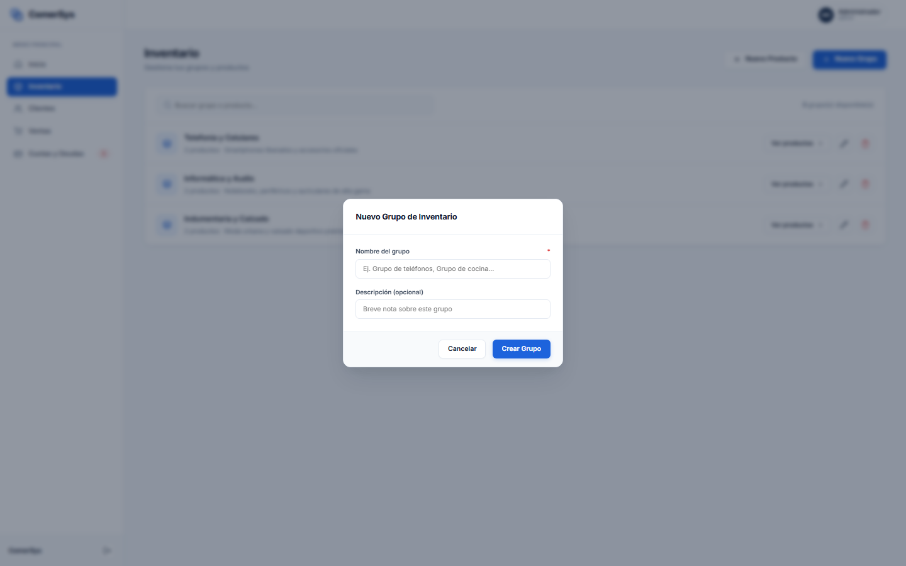

# Módulo 03: Inventario y Gestión de Productos

Este módulo administra de forma centralizada la mercadería, categorías y existencias del negocio.

---

## 1. Vista de Grupos de Inventario

### ¿Qué es este apartado?
Es la pantalla principal del catálogo de inventario. Agrupa los productos en familias o categorías comerciales dinámicas (creadas según la necesidad de la empresa) facilitando una navegación ordenada.

### ¿Para qué sirve?
- Permite clasificar productos por rubro (ej. *Telefonía y Celulares*, *Informática y Audio*, *Indumentaria y Calzado*).
- Brinda acceso rápido con un clic a los artículos contenidos en cada categoría mediante el botón **«Ver productos»**.
- Muestra el total de productos cargados por grupo y provee acciones directas para editar o eliminar categorías.

---

## 2. Vista de Productos por Grupo

### ¿Qué es este apartado?
Es el inventario detallado de una categoría específica. Presenta una tabla completa con todos los artículos asignados a ese grupo.

### ¿Para qué sirve?
- Permite visualizar en una sola vista: **Nombre del producto**, **Código interno / SKU**, **Stock disponible**, **Precio de costo (compra)**, **Precio de venta al público**, **Margen de ganancia calculado** y **Acciones operativas**.
- Incluye indicadores semánticos de stock: alerta verde para existencias óptimas y alerta naranja/roja para stock bajo o crítico.
- Permite registrar salidas rápidas de mercadería o editar la ficha técnica del producto.

---

## 3. Modal: Registro de Nuevo Producto

### ¿Qué es este apartado?
Es el formulario modal interactivo para dar de alta un nuevo artículo o mercadería en el inventario.

### ¿Para qué sirve?
- Permite ingresar la información esencial del producto:
  - **Grupo:** Selección de la categoría a la que pertenece.
  - **Código:** Identificador único o código de barras (con generación automática inteligente de prefijo si se desea).
  - **Nombre del producto:** Denominación clara y completa.
  - **Stock inicial:** Cantidad física existente al momento de la carga.
  - **Precio de compra:** Costo unitario neto del artículo.
  - **Precio de venta:** Precio final de venta al consumidor.
- **Cálculo de Ganancia en Tiempo Real:** Al ingresar los precios de costo y venta, el sistema calcula y muestra instantáneamente el margen monetario y el porcentaje de rentabilidad unitaria (`Ganancia unitaria calculada: $X (+Y%)`).

---

## 4. Modal: Creación de Nuevo Grupo

### ¿Qué es este apartado?
Es la ventana emergente para crear nuevas agrupaciones o familias comerciales en el catálogo.

### ¿Para qué sirve?
- Permite definir el **Nombre del grupo** (obligatorio) y una **Descripción complementaria** (opcional).
- Al guardarse, queda disponible de forma inmediata tanto en los filtros de inventario como en el selector del asistente de ventas y reportes ejecutivos.
