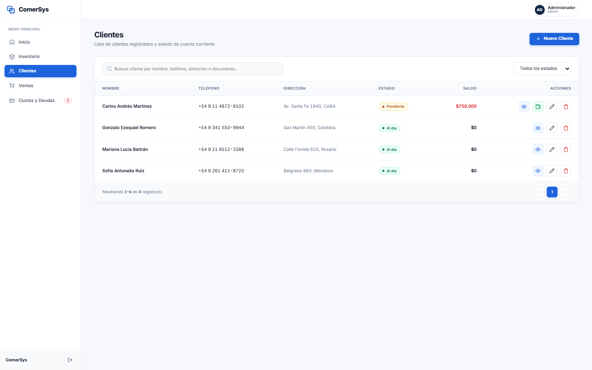
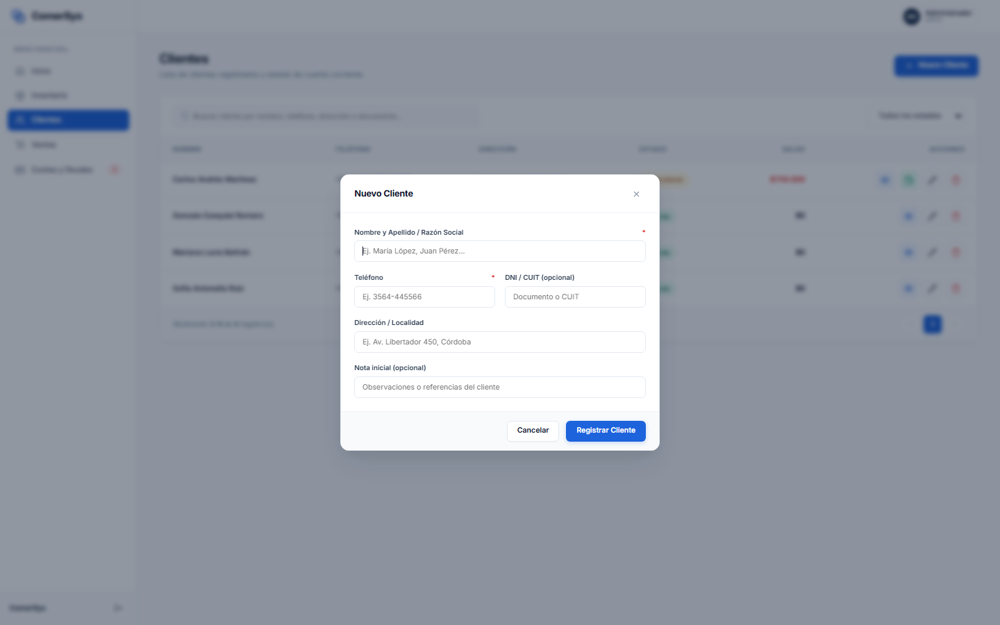
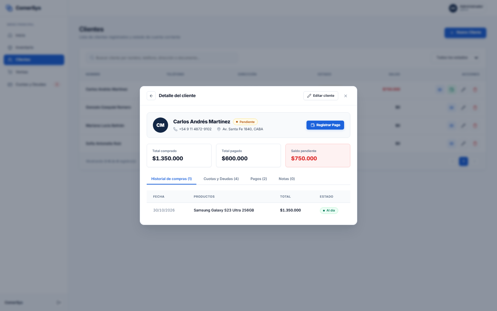

# Módulo 04: Clientes y Cuentas Corrientes

Este módulo centraliza el padrón de compradores, datos de contacto, saldos deudores e historiales de operaciones.

---

## 1. Listado General de Clientes

### ¿Qué es este apartado?
Es el directorio integral de personas y empresas registradas en la base comercial de **ComerSys**.

### ¿Para qué sirve?
- Permite consultar rápidamente a todos los clientes junto con sus datos esenciales:
  - **Nombre y Apellido / Razón Social**
  - **Teléfono de contacto**
  - **Dirección física o Localidad**
  - **Estado de su cuenta corriente** (Al día, Pendiente, Atrasado, Cancelado)
  - **Saldo total adeudado** (destacado en rojo si tiene pagos pendientes)
- **Filtros y Búsqueda en Vivo:** Permite filtrar por texto (nombre, teléfono o documento) y por estado de cuenta (*Todos los estados*, *Al día*, *Con saldo pendiente*).
- **Acciones Rápidas:**
  - Ver ficha integral del cliente (icono de ojo).
  - Registrar cobro directo (icono de billetera).
  - Editar datos (icono de lápiz).
  - Eliminar cliente (icono de papelera, con validación de seguridad que impide borrar clientes con deuda activa).

---

## 2. Modal: Alta y Edición de Cliente

### ¿Qué es este apartado?
Es la ventana emergente para registrar un nuevo cliente en el sistema o modificar sus datos existentes.

### ¿Para qué sirve?
- Permite recopilar y validar la identidad del comprador:
  - **Nombre y Apellido / Razón Social** *(obligatorio)*.
  - **Teléfono** *(obligatorio)*: Canal de comunicación directo.
  - **DNI / CUIT** *(opcional)*: Identificación fiscal con validación anti-duplicados.
  - **Dirección / Localidad** *(opcional)*: Domicilio para entregas o referencias.
  - **Nota inicial / Observaciones** *(opcional)*: Comentarios sobre preferencias comerciales o límites de crédito.

---

## 3. Modal: Ficha Detallada del Cliente

### ¿Qué es este apartado?
Es la ficha clínica y comercial de 360 grados del cliente seleccionado.

### ¿Para qué sirve?
- **Resumen Financiero en Cabecera:**
  - Avatar con iniciales, nombre, teléfono y dirección.
  - Estado de cuenta actual con insignia (*Al día*, *Pendiente*, *Atrasado*).
  - Métricas acumuladas: **Total comprado**, **Total pagado** y **Saldo pendiente** en rojo.
  - Botón directo **«Registrar Pago»** para imputar cobros en el acto.
- **Pestañas de Consulta Histórica:**
  1. **Historial de compras:** Todas las ventas efectuadas al cliente, fechas, productos adquiridos, totales y estados.
  2. **Cuotas y Deudas:** Detalle de cada plan de cuotas o cuenta corriente acordada con el cliente.
  3. **Pagos:** Registro cronológico de todos los cobros recibidos (efectivo, transferencias, cuotas).
  4. **Notas:** Bitácora interna de anotaciones y seguimiento sobre el cliente.
