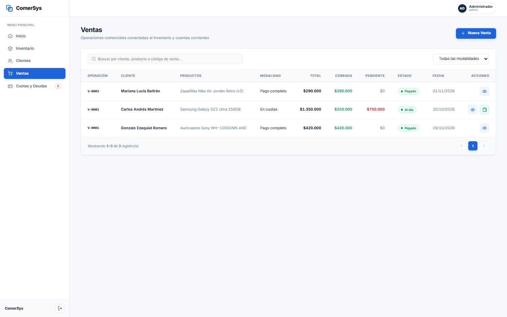
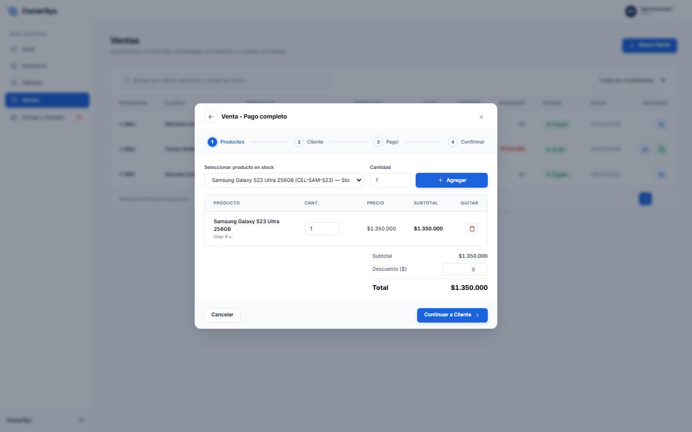
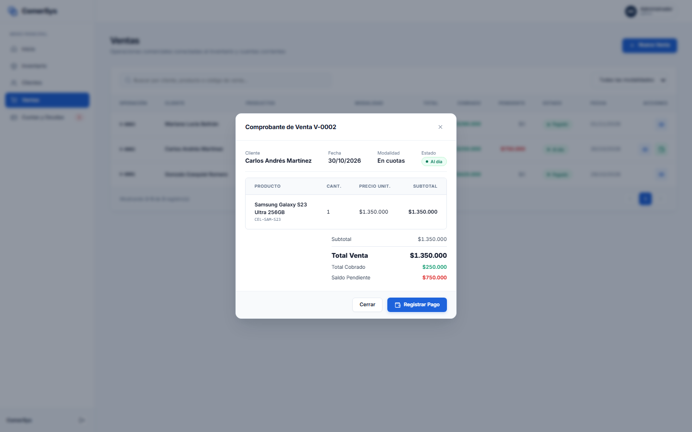

# Módulo 05: Ventas y Punto de Venta (POS)

Este módulo gestiona la registración comercial de pedidos, ventas al contado, ventas financiadas en cuotas, emisión de comprobantes y descuento automático de existencias del inventario.

---

## 1. Historial de Operaciones Comerciales

### ¿Qué es este apartado?
Es el libro maestro de transacciones de venta registradas en **ComerSys**.

### ¿Para qué sirve?
- Permite supervisar todas las salidas de mercadería y sus condiciones comerciales:
  - **Código de operación:** Identificador secuencial oficial (ej. `V-0001`, `V-0002`).
  - **Cliente:** Nombre del comprador registrado o Consumidor Final.
  - **Productos:** Resumen de los artículos incluidos y sus cantidades.
  - **Modalidad:** Pago completo, Pago parcial o Financiación en cuotas.
  - **Total de la venta:** Importe total pactado.
  - **Cobrado:** Dinero efectivamente percibido hasta el momento.
  - **Pendiente:** Saldo remanente adeudado por el cliente.
  - **Estado:** Insignias dinámicas de estado (*Pagado*, *Al día*, *Atrasado*).
  - **Fecha:** Día de concreción de la operación.
  - **Acciones:** Ver comprobante detallado (ojo) y registrar cobro de cuota (billetera).
- **Botón «+ Nueva Venta»:** Ubicado en la esquina superior derecha para iniciar rápidamente una nueva venta.

---

## 2. Asistente Paso a Paso de Nueva Venta (Wizard POS)

### ¿Qué es este apartado?
Es el asistente inteligente interactivo guiado en 4 pasos para formalizar cualquier transacción comercial sin margen de error humano.

### ¿Para qué sirve?
Garantiza que una venta cumpla con todas las validaciones de stock, cliente y condiciones financieras antes de guardarse en el sistema.

### ¿Cómo funciona el flujo de 4 pasos?
1. **Paso 1 — Selección de Productos:**
   - Se elige el producto desde el catálogo desplegable (que muestra el stock real disponible).
   - Se indica la cantidad deseada y se presiona **«+ Agregar»**.
   - El producto pasa a la tabla del carrito donde se puede ajustar la cantidad o aplicar un descuento en dinero ($).
   - El sistema calcula y actualiza en tiempo real el Subtotal, Descuento y Total.
2. **Paso 2 — Selección del Cliente:**
   - Se selecciona un cliente existente del padrón o se crea uno nuevo directamente desde una ventana emergente sin abandonar la venta en curso.
   - En ventas al contado también es posible facturar a *Consumidor Final*.
3. **Paso 3 — Modalidad de Pago y Financiación:**
   - Se elige la modalidad:
     - **Pago completo:** Se abona la totalidad de contado, tarjeta o transferencia.
     - **Pago parcial:** El cliente realiza una entrega inicial y el resto queda en cuenta corriente.
     - **En cuotas:** Se configura la cantidad de cuotas (ej. 3, 6, 12 cuotas), la frecuencia (mensual, quincenal, semanal), la fecha de la primera cuota y el anticipo o entrega inicial. El sistema calcula automáticamente el valor exacto de cada cuota.
4. **Paso 4 — Confirmación Transaccional Atómica:**
   - Se revisa el resumen final y se hace clic en **«Confirmar Venta»**.
   - **Garantía ACID de ComerSys:** En una sola fracción de segundo, el sistema descuenta el stock de cada producto, registra la venta oficial, computa el ingreso de caja en Finanzas y crea el plan de cuotas y la deuda en el módulo de Cuotas y Deudas.

---

## 3. Modal: Comprobante y Detalle de Venta

### ¿Qué es este apartado?
Es el recibo y comprobante digital oficial de la operación completada.

### ¿Para qué sirve?
- Permite auditar en detalle la transacción: código de venta, cliente, fecha exacta, modalidad de pago y estado de cancelación.
- Muestra el desglose de productos: código SKU, cantidad adquirida, precio unitario y subtotal.
- Presenta el balance económico: **Total Venta**, **Total Cobrado** y **Saldo Pendiente**.
- Proporciona un botón directo **«Registrar Pago»** en caso de que la operación tenga saldo pendiente, agilizando la cobranza en mostrador.
