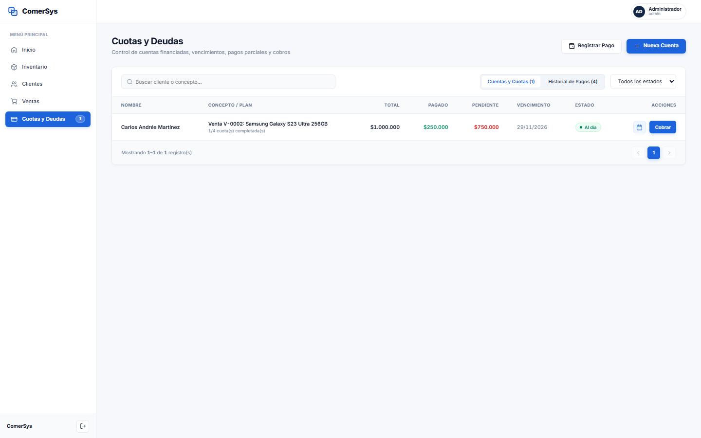
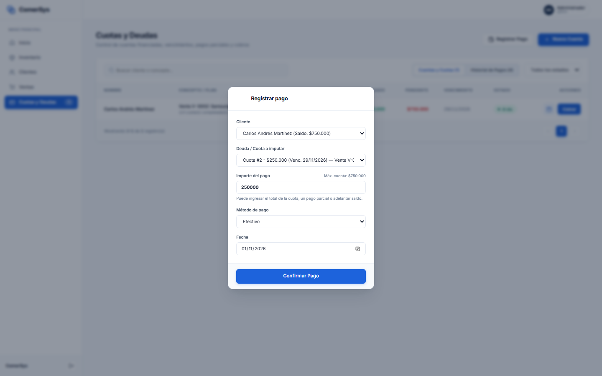
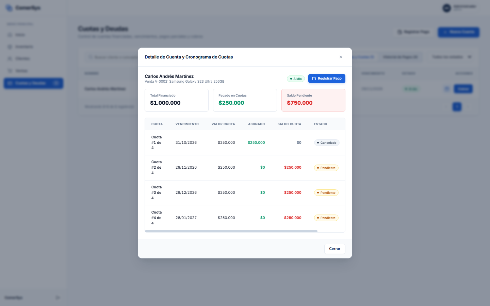

# Módulo 06: Cuotas y Deudas (Control Financiero y Cobranzas)

Este módulo controla la cartera crediticia del negocio: seguimiento de clientes con saldos pendientes, planes de cuotas, alertas de vencimiento y registro de pagos parciales o totales.

---

## 1. Tablero de Control de Cuentas Financiadas y Deudas

### ¿Qué es este apartado?
Es el panel centralizado para la administración de cuentas corrientes comerciales y financiación otorgada a clientes.

### ¿Para qué sirve?
- Permite supervisar con total claridad el estado de cada cuenta financiada:
  - **Nombre del Cliente:** Acompañado de su teléfono de contacto para gestión de cobranza.
  - **Concepto / Plan:** Venta vinculada, producto adquirido y avance de cuotas (ej. *1/4 cuota(s) completada(s)*).
  - **Importe Total Financiado:** Valor global de la operación.
  - **Total Pagado:** Monto amortizado acumulado por el cliente hasta la fecha.
  - **Saldo Pendiente:** Capital adeudado restante (marcado en rojo).
  - **Próximo Vencimiento:** Fecha límite exacta para el vencimiento de la siguiente cuota.
  - **Estado Dinámico:**
    - **Al día:** Cuotas pagadas a término o sin vencimientos superados.
    - **Atrasado:** Cuota con fecha de vencimiento vencida sin abonar.
    - **Pendiente:** Plan activo con cuotas futuras.
    - **Cancelado:** Deuda pagada en su totalidad al 100%.
- **Pestaña «Historial de Pagos»:** Permite alternar a la lista de todos los cobros históricos recibidos en caja con detalle de medio de pago y fecha.
- **Acciones Directas:**
  - Icono de calendario: Abre el cronograma completo de cuotas.
  - Botón azul **«Cobrar»**: Abre directamente el modal para imputar un pago.
  - Botón superior **«+ Nueva Cuenta»**: Permite otorgar una financiación manual directa a un cliente sin pasar por el carrito de venta de productos.

---

## 2. Modal: Registrar Pago y Cobro de Cuotas

### ¿Qué es este apartado?
Es la herramienta rápida de caja para asentar pagos en mostrador o transferencias bancarias recibidas.

### ¿Para qué sirve?
- **Selección Inteligente:**
  - Al elegir el cliente, el sistema calcula de inmediato su saldo total deudor.
  - Permite seleccionar a qué cuota o deuda específica imputar el cobro (indicando número de cuota, importe y fecha de vencimiento).
- **Flexibilidad de Cobro:**
  - El cliente puede abonar el valor exacto de la cuota.
  - Puede realizar un **pago parcial** (menor al valor de la cuota, recalculando el saldo pendiente restante).
  - Puede **adelantar cuotas o cancelar la deuda completa**.
- **Medio de Cobro y Fecha:** Selección de medio (*Efectivo*, *Transferencia*, *Tarjeta*, *Otro*) y fecha de registración contable.
- **Impacto Inmediato:** Al presionar **«Confirmar Pago»**, el sistema actualiza automáticamente el saldo del cliente, el estado de la cuota, el estado de la venta vinculada y suma el ingreso real a las estadísticas financieras del panel de inicio.

---

## 3. Modal: Cronograma Detallado de Cuotas

### ¿Qué es este apartado?
Es el estado de cuenta y plan de amortización detallado de una venta financiada.

### ¿Para qué sirve?
- **Resumen del Plan:** Muestra el cliente, venta asociada, insignia de estado (*Al día* / *Atrasado*), **Total Financiado**, **Pagado en Cuotas** y **Saldo Pendiente**.
- **Tabla Cronológica de Cuotas:**
  - **Cuota:** Identificador del número de cuota sobre el total (ej. *Cuota #1 de 4*, *Cuota #2 de 4*, etc.).
  - **Vencimiento:** Fecha exacta programada para el pago de cada cuota.
  - **Valor Cuota:** Cuota pactada original.
  - **Abonado:** Monto efectivamente cobrado de esa cuota.
  - **Saldo Cuota:** Remanente de la cuota (en rojo si aún no se abonó).
  - **Estado:** Badge semántico (*Cancelado* en gris, *Pendiente* en naranja o *Atrasado* en rojo).
- **Acceso Directo a Cobro:** Permite registrar pagos de cuotas específicas directamente desde esta misma pantalla sin necesidad de navegar a otros menús.
