# ComerSys — Manual de Usuario y Documentación del Sistema

Bienvenido a la documentación oficial del sistema **ComerSys — Sistema de Gestión Comercial ERP**.

Este documento ha sido confeccionado especialmente para brindar al cliente y a los operadores del sistema una guía visual, clara y completa de cada uno de los apartados de la plataforma, explicando su propósito comercial, su funcionamiento operativo y la interacción entre sus módulos.

---

## Índice General

1. [Módulo 01: Inicio de Sesión (Login)](#1-módulo-01-inicio-de-sesión-login)
2. [Módulo 02: Panel de Inicio (Dashboard Ejecutivo)](#2-módulo-02-panel-de-inicio-dashboard-ejecutivo)
3. [Módulo 03: Inventario y Gestión de Productos](#3-módulo-03-inventario-y-gestión-de-productos)
   - [3.1 Grupos de Inventario](#31-grupos-de-inventario)
   - [3.2 Productos por Grupo](#32-productos-por-grupo)
   - [3.3 Alta de Nuevos Productos](#33-alta-de-nuevos-productos)
   - [3.4 Creación de Nuevas Categorías/Grupos](#34-creación-de-nuevas-categoríasgrupos)
4. [Módulo 04: Clientes y Cuentas Corrientes](#4-módulo-04-clientes-y-cuentas-corrientes)
   - [4.1 Padrón General de Clientes](#41-padrón-general-de-clientes)
   - [4.2 Registro y Edición de Clientes](#42-registro-y-edición-de-clientes)
   - [4.3 Ficha Integral 360° del Cliente](#43-ficha-integral-360-del-cliente)
5. [Módulo 05: Ventas y Punto de Venta (POS)](#5-módulo-05-ventas-y-punto-de-venta-pos)
   - [5.1 Historial de Operaciones Comerciales](#51-historial-de-operaciones-comerciales)
   - [5.2 Asistente Guiado de Nueva Venta en 4 Pasos](#52-asistente-guiado-de-nueva-venta-en-4-pasos)
   - [5.3 Comprobante de Operación Comercial](#53-comprobante-de-operación-comercial)
6. [Módulo 06: Cuotas y Deudas (Financiación y Cobranzas)](#6-módulo-06-cuotas-y-deudas-financiación-y-cobranzas)
   - [6.1 Panel de Control de Cuentas Financiadas](#61-panel-de-control-de-cuentas-financiadas)
   - [6.2 Registro y Cobro de Cuotas](#62-registro-y-cobro-de-cuotas)
   - [6.3 Cronograma y Estado de Cuotas](#63-cronograma-y-estado-de-cuotas)
7. [Estructura de Carpetas de la Documentación](#7-estructura-de-carpetas-de-la-documentación)

---

## 1. Módulo 01: Inicio de Sesión (Login)

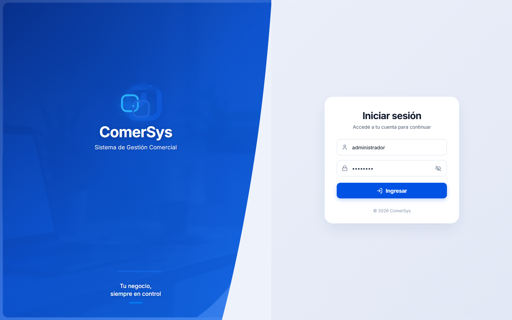

- **¿Qué es?** Es la pantalla de autenticación y acceso seguro a la plataforma. Diseñada con un estilo corporativo moderno de dos columnas: fotografía profesional y marca corporativa a la izquierda, y tarjeta de inicio de sesión con formulario minimalista a la derecha.
- **¿Para qué sirve?** Restringe el acceso a la información confidencial de la empresa (facturación, saldos, costos de compra, catálogo de clientes) asegurando que solo los operadores autorizados puedan interactuar con el sistema.
- **¿Cómo funciona?**
  1. El operador ingresa su nombre de usuario en el campo superior.
  2. Ingresa su clave secreta en el campo de contraseña.
  3. Puede hacer clic en el icono del ojo para visualizar u ocultar los caracteres.
  4. Presiona el botón azul **«Ingresar»**.
  5. El sistema valida los datos y da paso inmediato al Panel de Inicio.

---

## 2. Módulo 02: Panel de Inicio (Dashboard Ejecutivo)

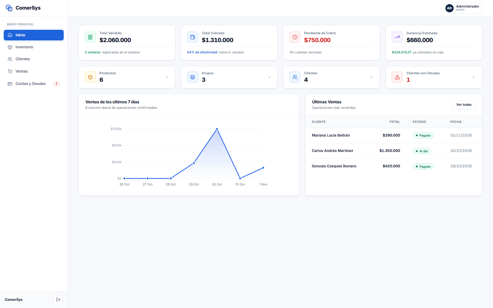

- **¿Qué es?** Es el centro de mando y resumen operativo en tiempo real de todo el negocio.
- **¿Para qué sirve?** Permite al administrador tomar decisiones comerciales rápidas basadas en datos reales consolidados al instante (ventas, cobros, margen de ganancia y dinero pendiente en la calle).
- **¿Cómo funciona?**
  - **Métricas Superiores (KPIs):**
    - **Total Vendido:** Importe total facturado acumulado y conteo de ventas.
    - **Total Cobrado:** Dinero que ya ingresó en caja y porcentaje de efectividad de cobro.
    - **Pendiente de Cobro:** Monto exacto que los clientes adeudan.
    - **Ganancia Estimada:** Margen neto obtenido descontando costos de mercadería.
  - **Tarjetas de Conteo Rápido:** Accesos directos con conteo en vivo de Productos, Grupos, Clientes y Clientes con Deudas.
  - **Gráfico de Evolución:** Curva interactiva de ventas de los últimos 7 días con nodos sobre los que pasar el cursor.
  - **Últimas Ventas:** Listado ágil de las operaciones recientes con enlaces directos a sus detalles.

---

## 3. Módulo 03: Inventario y Gestión de Productos

### 3.1 Grupos de Inventario
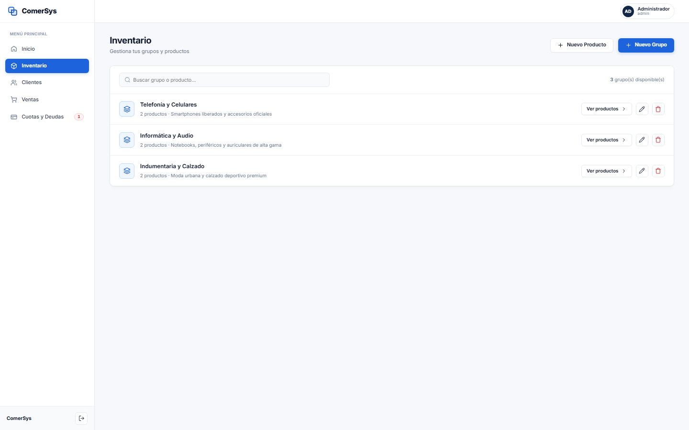

- **¿Qué es?** Clasificación por categorías o familias de productos.
- **¿Para qué sirve?** Mantiene el catálogo comercial segmentado y ordenado para que encontrar cualquier producto sea inmediato.
- **¿Cómo funciona?** Lista cada categoría con la cantidad de artículos disponibles. Al hacer clic en **«Ver productos»**, se ingresa a la lista detallada de ese grupo.

### 3.2 Productos por Grupo
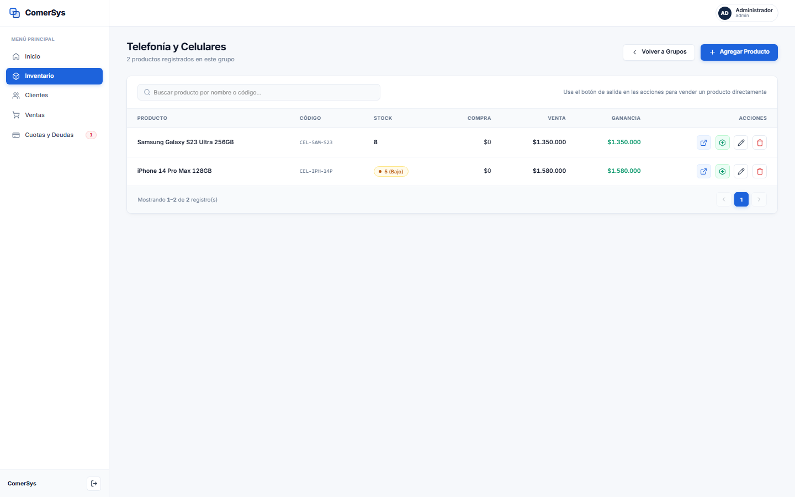

- **¿Qué es?** La tabla de existencias de una categoría específica.
- **¿Para qué sirve?** Monitorear existencias físicas, precios de costo, precios de venta y rentabilidad unitaria.
- **¿Cómo funciona?** Cada fila presenta el código SKU, denominación, stock actual con semáforo de aviso, costos, precio de venta, ganancia en pesos y porcentaje, y botones para editar o registrar salidas.

### 3.3 Alta de Nuevos Productos
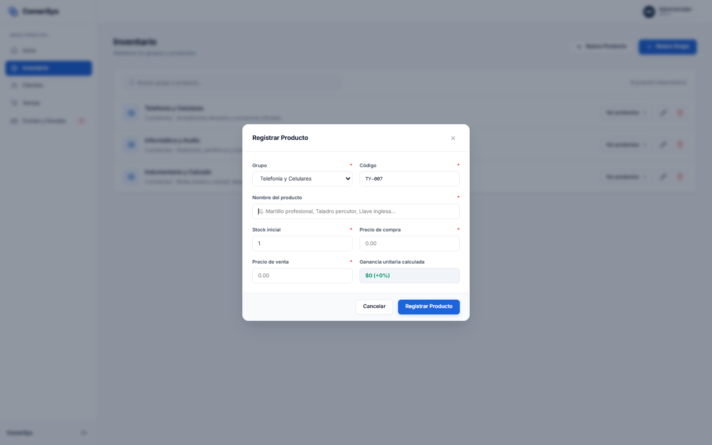

- **¿Qué es?** Formulario emergente para incorporar mercadería al catálogo.
- **¿Para qué sirve?** Registrar nuevos productos asociándolos a su respectivo grupo con cálculo automático de utilidad.
- **¿Cómo funciona?** Se selecciona el grupo, se define un código interno, se ingresa el nombre, stock inicial, precio de compra y precio de venta. Al tipear los valores, el sistema calcula en vivo la ganancia neta estimada.

### 3.4 Creación de Nuevas Categorías/Grupos
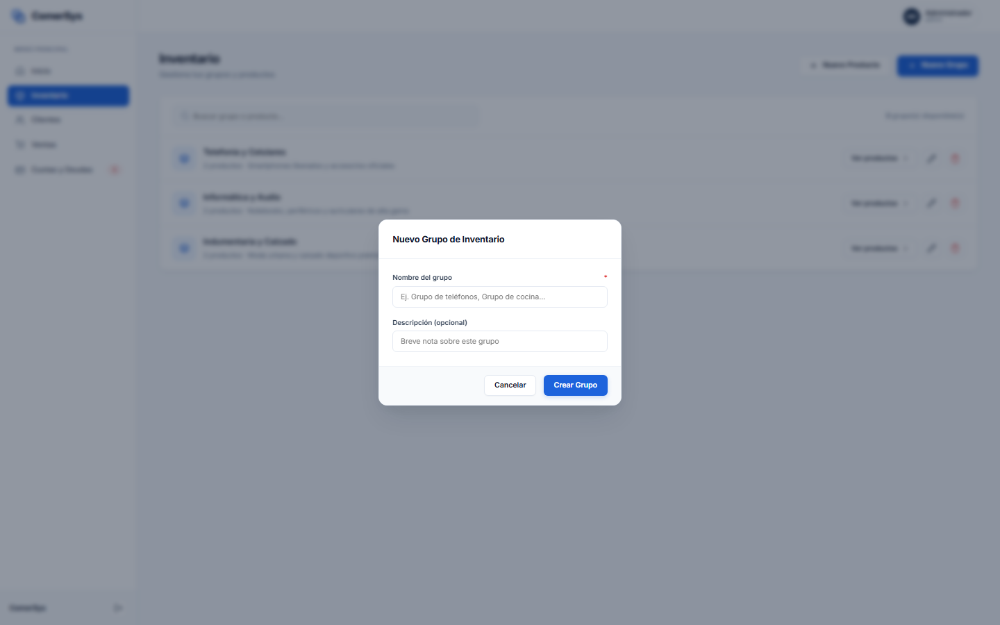

- **¿Qué es?** Formulario ágil para crear nuevos rubros o familias de artículos.
- **¿Para qué sirve?** Adaptar el sistema al crecimiento o diversificación de las líneas de producto del negocio.

---

## 4. Módulo 04: Clientes y Cuentas Corrientes

### 4.1 Padrón General de Clientes
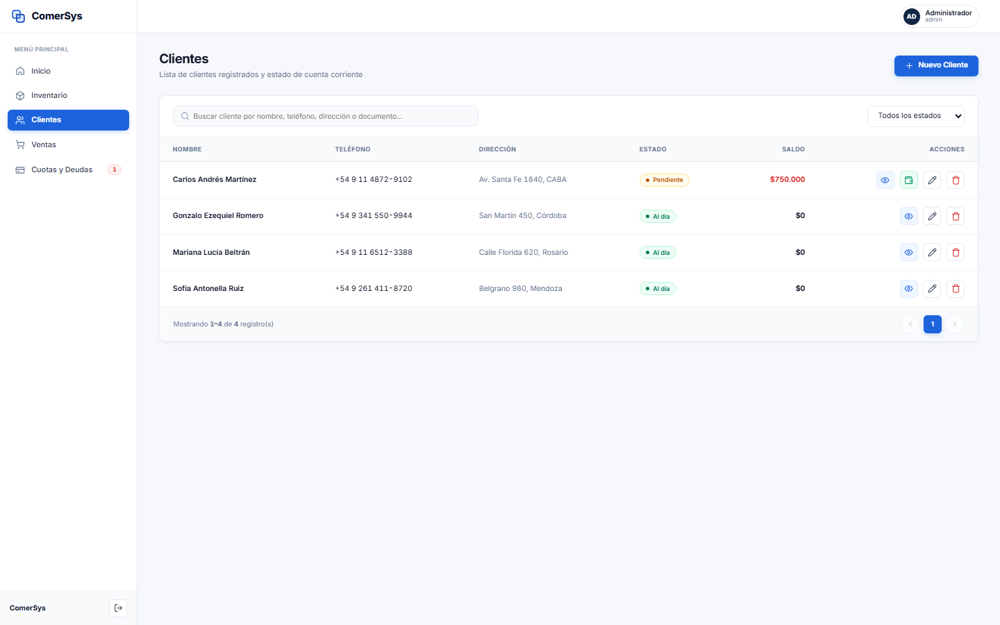

- **¿Qué es?** Directorio consolidado de clientes del establecimiento.
- **¿Para qué sirve?** Conocer en un solo vistazo la información de contacto, si el cliente se encuentra al día o adeuda dinero, y su saldo total pendiente.
- **¿Cómo funciona?** Incluye buscador por texto, filtro por estado de cuenta y botones para ver ficha integral, registrar pagos directos, editar datos o dar de baja.

### 4.2 Registro y Edición de Clientes
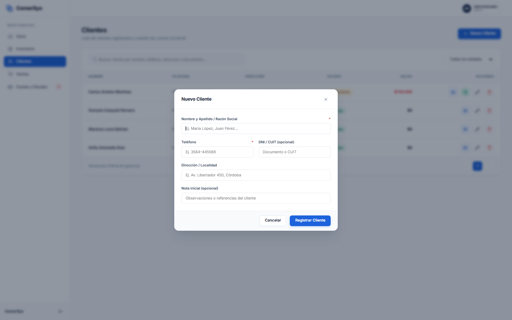

- **¿Qué es?** Formulario de alta para nuevos compradores o empresas.
- **¿Para qué sirve?** Guardar nombre, teléfono, documento fiscal (DNI/CUIT), dirección y observaciones de crédito.

### 4.3 Ficha Integral 360° del Cliente
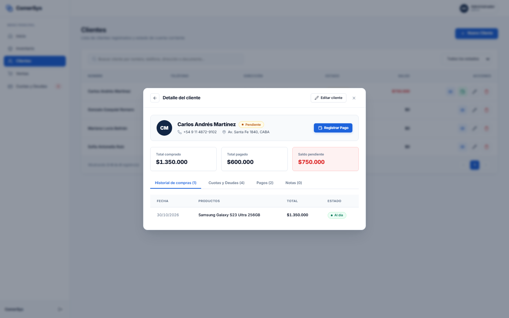

- **¿Qué es?** El expediente completo del cliente.
- **¿Para qué sirve?** Consultar en un único lugar cuánto ha comprado históricamente, cuánto ha pagado, cuánto debe actualmente y revisar sus pestañas de compras, cuotas activas, cobros asentados y notas.

---

## 5. Módulo 05: Ventas y Punto de Venta (POS)

### 5.1 Historial de Operaciones Comerciales
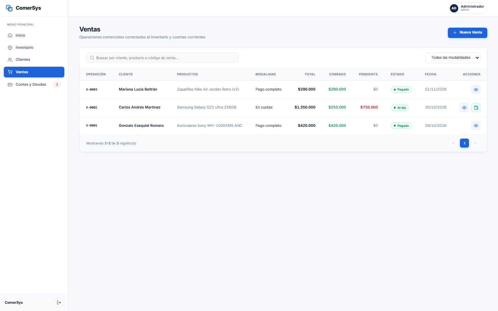

- **¿Qué es?** Registro cronológico oficial de todas las operaciones realizadas.
- **¿Para qué sirve?** Auditar facturación, consultar modalidades de venta (contado vs cuotas), estados de pago e ingresar rápidamente a nuevas ventas mediante el botón superior **«+ Nueva Venta»**.

### 5.2 Asistente Guiado de Nueva Venta en 4 Pasos (Wizard POS)
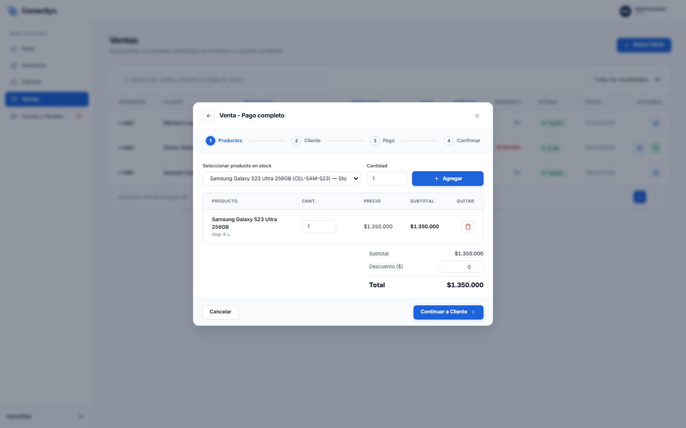

- **¿Qué es?** Flujo paso a paso para formalizar una venta con verificación atómica.
- **¿Cómo funciona?**
  1. **Paso 1 (Productos):** Se agregan productos del inventario y se aplican descuentos si corresponde.
  2. **Paso 2 (Cliente):** Se asocia la venta a un cliente registrado o a Consumidor Final.
  3. **Paso 3 (Pago y Cuotas):** Se elige Pago Completo, Pago Parcial o Financiación en Cuotas (con cálculo automático del valor de cuota, periodicidad y anticipo).
  4. **Paso 4 (Confirmación):** El sistema descuenta stock, crea la venta, genera la deuda y cuotas si aplica, y asienta el cobro contable en caja.

### 5.3 Comprobante de Operación Comercial
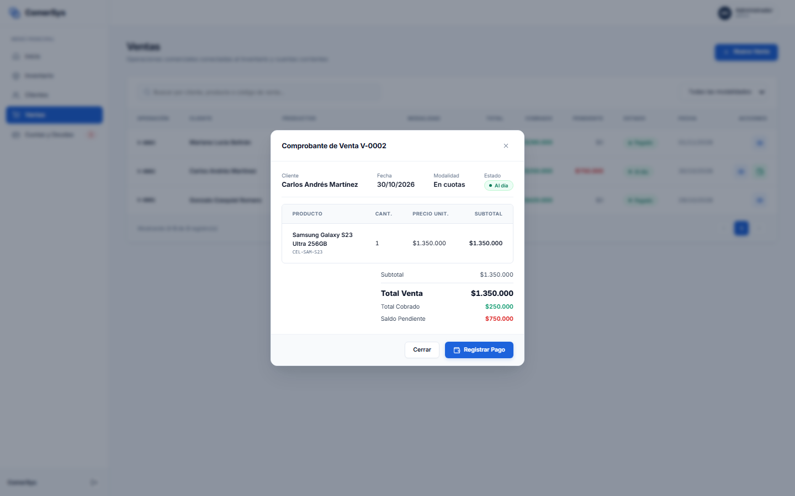

- **¿Qué es?** Recibo digital detallado con el desglose de productos, valores unitarios, totales y saldo pendiente.

---

## 6. Módulo 06: Cuotas y Deudas (Financiación y Cobranzas)

### 6.1 Panel de Control de Cuentas Financiadas
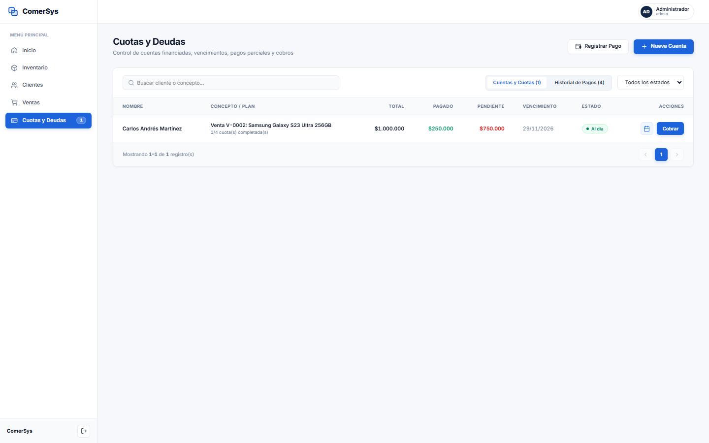

- **¿Qué es?** El centro de control de cobranzas de cuentas corrientes y ventas a crédito.
- **¿Para qué sirve?** Monitorear qué clientes tienen cuotas por vencer o vencidas, montos adeudados y fechas de cobro.

### 6.2 Registro y Cobro de Cuotas
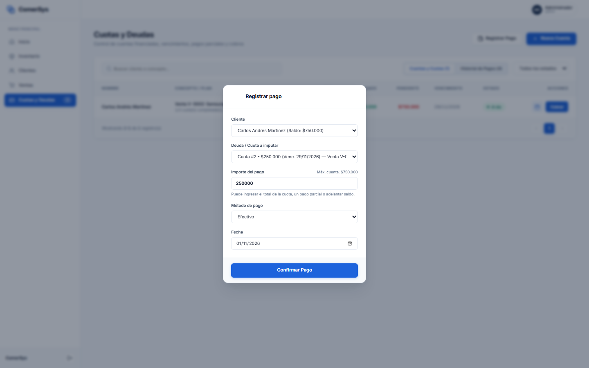

- **¿Qué es?** La herramienta para ingresar dinero recibido por cuotas o cancelaciones.
- **¿Para qué sirve?** Permite imputar pagos a una cuota puntual, realizar entregas parciales o cancelaciones totales con recálculo automático de saldos e impacto contable inmediato.

### 6.3 Cronograma y Estado de Cuotas
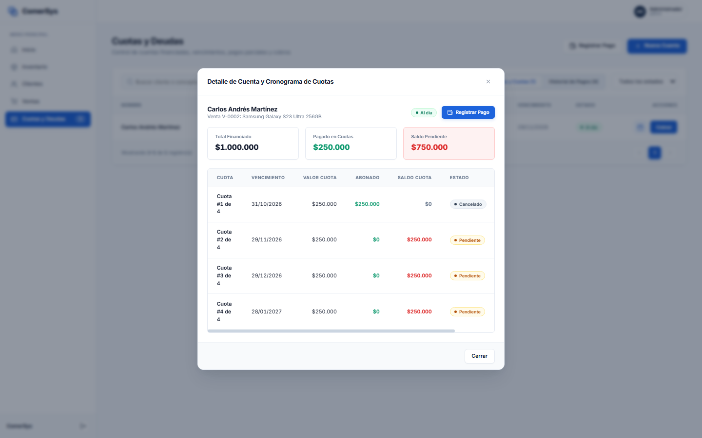

- **¿Qué es?** Plan de pagos desglosado cuota por cuota (Cuota 1 de 4, Cuota 2 de 4, etc.).
- **¿Para qué sirve?** Revisar fechas de vencimiento, importes cobrados, saldos restantes por cuota e insignias semánticas de estado (*Cancelado*, *Pendiente*, *Atrasado*).

---

## 7. Estructura de Carpetas de la Documentación

La documentación se encuentra completamente organizada dentro de la carpeta `documentacion/` del proyecto con la siguiente estructura de archivos:

```text
documentacion/
├── MANUAL_DE_USUARIO.md                 (Manual maestro integral)
├── index.html                           (Portal web interactivo para el cliente)
├── 01_inicio_sesion/
│   ├── 01_login_pantalla_principal.png
│   └── README.md
├── 02_panel_inicio/
│   ├── 01_dashboard_principal.png
│   └── README.md
├── 03_inventario/
│   ├── 01_inventario_grupos.png
│   ├── 02_inventario_productos_grupo.png
│   ├── 03_modal_nuevo_producto.png
│   ├── 04_modal_nuevo_grupo.png
│   └── README.md
├── 04_clientes/
│   ├── 01_listado_clientes.png
│   ├── 02_modal_nuevo_cliente.png
│   ├── 03_modal_detalle_cliente.png
│   └── README.md
├── 05_ventas/
│   ├── 01_historial_ventas.png
│   ├── 02_asistente_nueva_venta.png
│   ├── 03_modal_detalle_venta.png
│   └── README.md
└── 06_cuotas_y_deudas/
    ├── 01_control_deudas.png
    ├── 02_modal_registrar_pago.png
    ├── 03_modal_cronograma_cuotas.png
    └── README.md
```

Todos los archivos e imágenes están listos para ser presentados al cliente o distribuidos como material oficial de capacitación y referencia del software.
